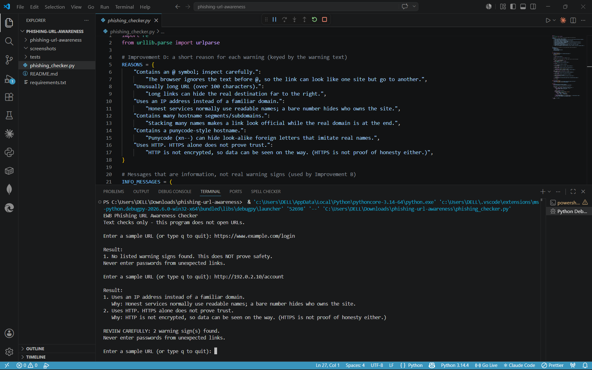
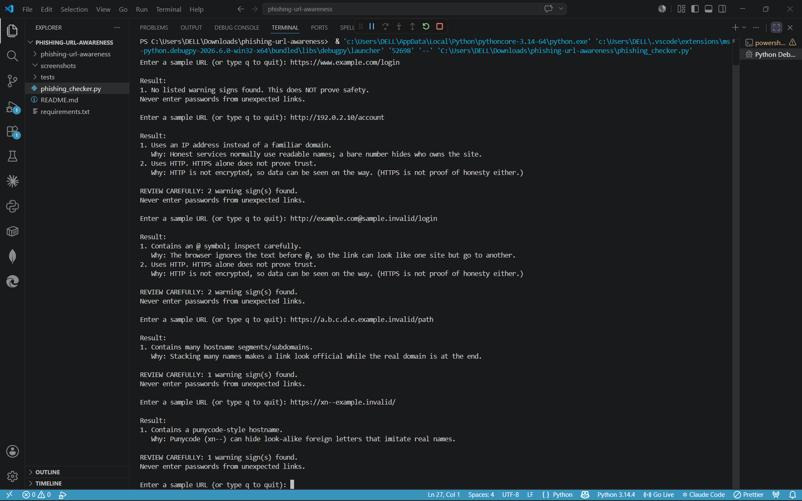

# EWB Phishing URL Awareness Checker

## Overview
Phishing is a trick where a criminal sends a fake link or message to make people share passwords, card numbers or OTPs. This command-line tool reads the text of a URL and points out a few visible warning signs. It never opens the link, so it is safe to use for learning.

## Features
- Detects an @ symbol in the URL
- Flags unusually long URLs (over 100 characters)
- Flags IP-address hostnames
- Flags many hostname segments (5 or more)
- Flags punycode-style hostnames (xn--)
- Flags the HTTP scheme
- Loop mode: check many URLs without restarting; type `q` to quit
- "REVIEW CAREFULLY" summary with the number of warnings
- Malformed input handled safely (no crashes)
- A one-line "Why" explanation under each warning

## Requirements
Python 3.10 or later. No extra packages.

## How to Run
Windows: `python phishing_checker.py`

Mac/Linux: `python3 phishing_checker.py`

## Example Output
```
EWB Phishing URL Awareness Checker
Text checks only - this program does not open URLs.

Enter a sample URL (or type q to quit): http://192.0.2.10/account

Result:
1. Uses an IP address instead of a familiar domain.
   Why: Honest services normally use readable names; a bare number hides who owns the site.
2. Uses HTTP. HTTPS alone does not prove trust.
   Why: HTTP is not encrypted, so data can be seen on the way. (HTTPS is not proof of honesty either.)

REVIEW CAREFULLY: 2 warning sign(s) found.
Never enter passwords from unexpected links.
```

## Testing
| # | Input | Expected | Actual | Result |
|---|-------|----------|--------|--------|
| 1 | https://www.example.com/login | No warning signs | No listed warning signs found | PASS |
| 2 | http://192.0.2.10/account | IP address + HTTP | IP address + HTTP flagged | PASS |
| 3 | http://example.com@sample.invalid/login | @ symbol + HTTP | @ symbol + HTTP flagged | PASS |
| 4 | https://a.b.c.d.e.example.invalid/path | Many hostname segments | Many hostname segments flagged | PASS |
| 5 | https://xn--example.invalid/ | Punycode-style hostname | Punycode-style hostname flagged | PASS |

The full table with bonus checks is in [tests/test_samples.md](tests/test_samples.md).

## Screenshots



## Improvements
1. **Loop with quit (A)** - `main()` now uses a `while True` loop so several URLs can be checked in one session; `q`, `quit` or `exit` ends it. Tested by entering two URLs and then `q`.
2. **Review carefully summary (B)** - a helper `has_warnings()` tells real warnings apart from information messages, and the program prints `REVIEW CAREFULLY: N warning sign(s) found.` only when there are real warnings. Tested with all five samples (the summary appears for samples 2-5 but not sample 1).
3. **Malformed input handling (C)** - `urlparse` is wrapped in `try/except ValueError`, so `http://[bad` prints "This text is not a valid URL format." instead of crashing. Tested with `http://[bad`.
4. **Explain each warning (D)** - a `REASONS` dictionary maps each warning to a one-line "Why" shown under it. Tested by re-running all five samples and checking the reasons appear.

After each change I re-ran all five tests to make sure nothing broke.

## Limitations
This is an educational tool. It only reads URL text. It does not visit URLs, scan for malware or prove that a URL is safe. No warning signs found does NOT mean a URL is safe.

## Ethical Use
Use sample strings only. Do not collect credentials. Do not use this project to deceive anyone or to test websites without permission.

## Author
Name:Gude Rajesh

GitHub Username:rajeshgude1625

GitHub Repository:https://github.com/rajeshgude1625/GudeRajesh_phishing-url-awareness_project.git

Internship:EWB AI POWERED CYBERSECURITY INTERNSHIP
